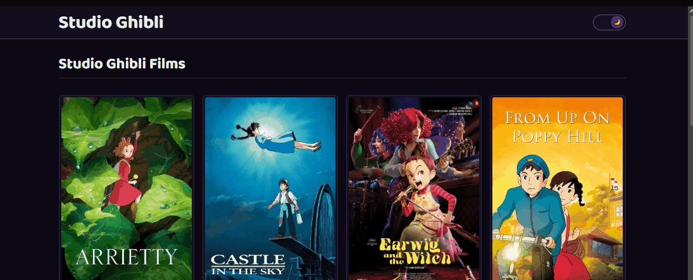

# Studio Ghibli - Catálogo de Filmes


Esse é o meu desafio de consumo de API REST no front. A ideia era simples: pegar os filmes do Studio Ghibli de uma API pública, listar em ordem alfabética e ter uma página de detalhes pra cada um.

A API é a [ghibliapi.vercel.app](https://ghibliapi.vercel.app/films), que não pede chave nem autenticação.

## Demonstração



## O que dá pra fazer

- Ver os filmes ordenados alfabeticamente (a lista vem completa da API, mostro 10 por vez).
- Clicar em "More films" pra carregar mais 10, até acabar.
- Abrir a página de detalhes de cada filme com diretor, produtor, duração, descrição e ano.
- Ver a nota do Rotten Tomatoes com um ícone que muda conforme o score (certified fresh, fresh ou rotten).
- Alternar entre tema claro e escuro (o toggle fica no header, e a escolha fica salva no localStorage).

## Como foi feito

- **React 19** pra interface.
- **TypeScript** pra tipar os dados que vêm da API.
- **React Router DOM** nas rotas: `/` (listagem) e `/films/:id` (detalhes).
- **Tailwind CSS v4** na estilização, incluindo o efeito de vidro no header e nos cards.
- **Fetch API** direto nos endpoints, sem lib de HTTP.

O consumo da API ficou isolado em `src/services/ghibliApi.ts`, e o estado em dois hooks: `useFilms` (listagem + paginação) e `useFilm` (detalhes por id).

## Rodando o projeto

Precisa do [Node.js](https://nodejs.org/) instalado.

```bash
git clone https://github.com/joaofelipebitencourt/desafio-api-studio-ghibli.git
cd desafio-api-studio-ghibli
npm install
npm run dev
```

Abre no endereço que o Vite mostrar no terminal (normalmente `http://localhost:5173`).

Outros comandos:

```bash
npm run build    # build de produção
npm run preview  # serve o build local
npm run lint     # roda o ESLint
```

## Estrutura

```
src/
  components/   # Card, Header, Layout, RottenTomatoes, ThemeToggle
  hooks/        # useFilms, useFilm, useTheme
  pages/        # Home, FilmDetails
  routes/       # Router
  services/     # ghibliApi.ts
  types/        # tipos dos filmes
```